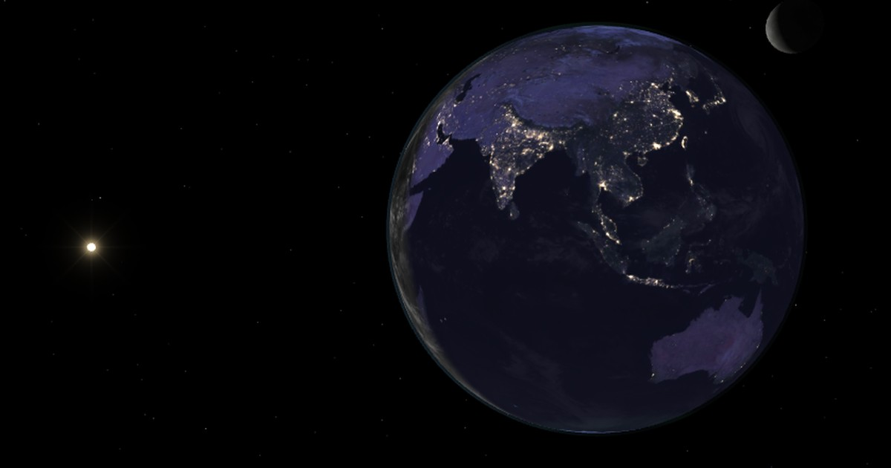
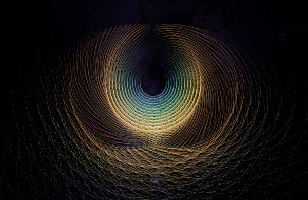
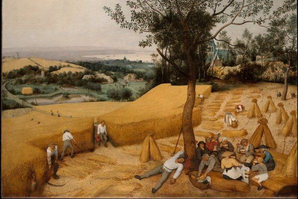
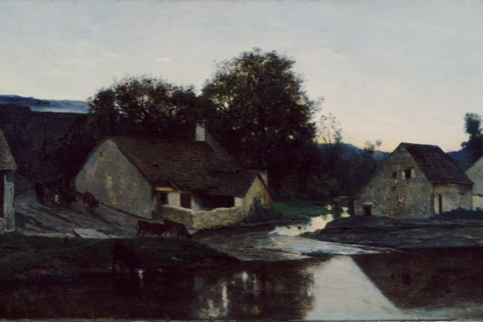
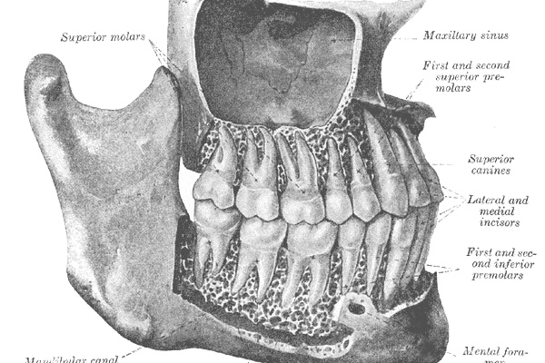

# Ethan Willingham

I build games and interactive demos for fun, and write the articles I want to read.

**[Visit the site](https://ethanwillingham.com/)** · [About and build history](https://ethanwillingham.com/about.html) · [In progress](https://ethanwillingham.com/archive.html)

<a href="https://ethanwillingham.com/daylight-globe.html">
  
</a>

**[Earth Now](https://ethanwillingham.com/daylight-globe.html)**

Spin a globe with satellite clouds, sunlight and NOAA aurora forecasts, then scrub through the last twelve hours.

<table>
  <tr>
    <td width="50%" valign="top">
      <a href="https://ethanwillingham.com/random-galaxy.html">
        
      </a>
      <h3><a href="https://ethanwillingham.com/random-galaxy.html">A Million Points of Light</a></h3>
      <p>Fly through a million points arranged into strange attractors, fractals and other mathematical structures.</p>
    </td>
    <td width="50%" valign="top">
      <a href="https://ethanwillingham.com/enough.html">
        
      </a>
      <h3><a href="https://ethanwillingham.com/enough.html">How Much Is Enough?</a></h3>
      <p>Move the markers on charts of walking, sleep, protein and more. Each chart includes its research sources and calculation details.</p>
    </td>
  </tr>
  <tr>
    <td width="50%" valign="top">
      <a href="https://ethanwillingham.com/gallery.html">
        
      </a>
      <h3><a href="https://ethanwillingham.com/gallery.html">The Old Masters</a></h3>
      <p>A gallery of paintings, with short notes on the artists. Open an image and zoom in for a closer look.</p>
    </td>
    <td width="50%" valign="top">
      <a href="https://ethanwillingham.com/optional-body.html">
        
      </a>
      <h3><a href="https://ethanwillingham.com/optional-body.html">The Optional Body</a></h3>
      <p>An illustrated walk through the parts of the body people can live without, from a spare foot bone to a heart on a machine.</p>
    </td>
  </tr>
</table>

## How it's built

GitHub Pages serves the site from `main`. The pages use HTML, CSS and JavaScript, with Canvas, WebGL, WebGPU and Three.js for the interactive pieces.

I use Claude and Codex to work on the site. The build history, recorded model contributions and usage calculations are documented on the [About page](https://ethanwillingham.com/about.html).

<details>
<summary>Run locally and find your way around</summary>

With Python 3 installed, run this from the repository root.

```sh
python -m http.server 8080 --bind 127.0.0.1
```

Open [localhost:8080](http://localhost:8080/). Some demos need WebGL or WebGPU support in the browser. Individual projects have their own build and data requirements, documented alongside their source.

| Path | Contents |
| --- | --- |
| Root HTML files | Page entry points |
| [`style.css`](style.css) | Shared palette, typography and layout |
| [`js/`](js/) | Page scripts and simulations |
| [`assets/`](assets/) | Images, fonts, audio and built assets |
| [`tools/`](tools/) | Data generators, publishing helpers and checks |
| [`docs/`](docs/) | Project notes and development instructions |

</details>
