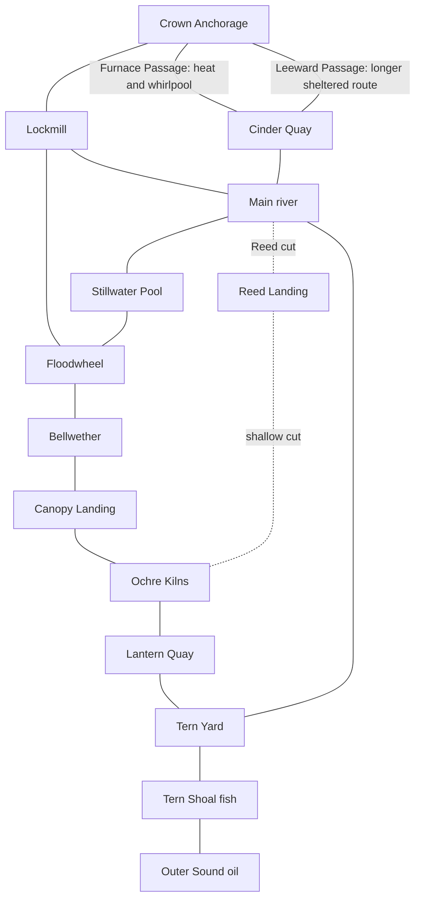

# Widewake water atlas and voyage pacing

Owner direction, 2026-10-19: think seriously about time between places, enemies
as the voyage develops, a narrow connected map, memorable scenery, and water
hazards with physical consequences for every boat. Avoid boring passages.
The gorillas, volcano and whirlpools were examples, not the full creative brief.

This is the route plan and first playable map pass, v0.27. It extends Bracken
Reach without replacing its coordinates. The world now has ten trading
ports, fifteen channel paths, three working grounds, twenty-four named shore
landmarks, and two alternatives around the volcanic reach. This is a foundation
for authored encounters and finished art, not a finished campaign claim.

## The shape of a voyage

Build a chain of waters with land continually in view. Small lakes are rooms;
bends, cuts and races connect them. A lake gives a fleet space to gather, fight
or work. A narrow passage changes how the player drives. A branch should offer
a practical choice about draft, danger, trading or time. Avoid a large empty
ocean as the opening experience.

Every passage needs three things: an anticipation cue, something that changes
while crossing it, and an arrival that looks different from departure. The
return trip should expose the other bank, reverse the current advantage, and
carry a different cargo. A camera tour or a periodic enemy spawn does not by
itself make a passage interesting.

Time is real sailing time, excluding decisions in port, combat delays and manual
detours. The chart reports a range for the current fleet. The helmsman uses its
slowest surviving boat, the plotted water distance, bends and signed current.
The estimate is deliberately a range because fights, traffic and the race cycle
change the result. A large convoy must not be sold a launch's ETA.

| Part of the voyage | Timing rule | Purpose |
| --- | --- | --- |
| First delivery | 45 to 85 seconds | Prove steering, arrival, sale and reward quickly |
| Early neighboring ports | About 60 to 100 seconds in the launch | A complete trade can fit a short session |
| A longer regional crossing | About 2 to 3 minutes before combat | Give a sustained maneuver or a deliberate bypass room to matter |
| Empty travel between readable moments | Aim for 15 to 25 seconds; review anything over 35 | Shore activity, a bend, a choice or a useful sighting, not constant ambushes |
| Early fishing watch | 65 seconds after the boat reaches station | See cargo accumulate and defend a real working hull |
| Distant destination across several districts | Show the whole ETA and intermediate ports | Never disguise several passages as one quick errand |

The starter launch's automatic cruise is now 20 m/s, matching its existing
manual top speed. Larger captains retain conservative channel cruise and the
existing faster manual helm. Cargo inertia, slowing for bends, full-hull
clearance and following boats still operate. These are arcade speeds, not a
claim about real naval travel.

## Connected map

The graph is additive. Old main-channel, reed-cut, port, work and fleet
positions remain water. The new western loop supplies frequent neighboring
destinations; it does not force every old upriver voyage around that loop.

The route tests physically sail each new adjacent leg in both directions with
the launch and the 86 m frigate. A separate connected test carries real followers
through trading, fishing, oil production, Lockmill and home. Visual fixtures
are not used as evidence of travel.

| Link | Distance | Measured launch sailing, outward / return | Decision and character |
| --- | --- | --- | --- |
| Tern Yard to Lantern Quay | 1.08 km | 56 / approximately 60 seconds | Sheltered first delivery, sailmakers and a lantern ferry |
| Lantern Quay to Ochre Kilns | 1.25 km | 64 / 72 seconds | Two gentle bends; grain market to firing terraces |
| Ochre Kilns to Canopy Landing | 1.56 km | 77 / 89 seconds | Narrow jungle bends, hanging orchard and gorilla bank |
| Canopy Landing to Bellwether | 1.67 km | 82 / 98 seconds | White bird roosts give way to the drowned town |
| Bellwether to Floodwheel | 1.50 km | 70 / 94 seconds | A changing race helps one direction and costs room in the other |
| Floodwheel to Lockmill | 1.41 km | 68 / 88 seconds | Timber ribs and millpond exchange; a gentler recovery leg |
| Lockmill to Crown Anchorage | 2.11 km | 102 / 125 seconds | Basalt columns, shipbreakers and higher patrol pressure |
| Cinder Quay to Crown, outside | 3.57 km | 180 / 199 seconds | Extra distance buys clear water around both hazards |
| Cinder Quay to Crown, furnace | 2.60 km | 137 seconds outward | Shorter distance, hull-damaging water and a rotating current |
| Reed Landing to Ochre Kilns | 1.52 km | 85 / 76 seconds | A useful small-boat connection that deep fleets cannot use |

Measurements use the production helm with combat admission disabled to isolate
navigation, no position jumps during a passage, and an unupgraded launch. The
automated first delivery separately retains ordinary campaign behavior. Current
phase and fleet composition change timings. Generated measurements are written
by `test-waterways.cjs`, including the large hull checks. The direct furnace crossing cost 33 of the launch's 200 hull points in the
measured run, while the sheltered crossing cost none. The test now rejects an
unexpected adjacent-port route over 4.5 km; it caught a Crown pier that forced a
frigate onto a 9.8 km detour before the berth was moved.

Existing connections remain: Tern Yard to the mouth and shoal, the main river to
Reed cut and Lockmill, Stillwater Pool along that river, and the oil grounds in
Outer Sound. Blackglass Strait joins the main river at its eastern bend. Heron
Spill joins Floodwheel to Stillwater Pool. Main-river destinations can still be
several minutes apart; their chart estimate must remain honest. Future work
should add a useful stop or encounter there before adding more distant land.

## Places with a reason to exist

The shipped pass provides original geometry, materials, shore clearings, port
buildings, regional ground colors and named discoveries. Below, the scene nouns
are implemented; the longer scene behaviors are the next authored encounter
briefs, not claims about existing NPC simulation.

| District | What makes it recognizable | Navigation, trade and encounter direction |
| --- | --- | --- |
| Lantern Water | Laundry-sized sails drying on poles, strings of ochre lanterns, a small grain quay | A calm home lake. The first salt sale opens Fleet. Later, a ferry crossing should provide a courteous driving beat without hostile pressure. Returning home should feel safe. |
| Potters Run | Stacked ochre kilns, rows of cooling jars, narrow working docks | Cheap tools and grain connect to the jungle trade. A future firing cycle can light the bank and send a short steam cloud over a side inlet, leaving the main lane readable. |
| Gorilla Narrows | Tall buttress roots, hanging orchard, a quiet troop on a clear bank | Fast hostile skiffs become relevant in bends. Future shore behavior: a youngster drops fruit, an adult retrieves it, birds lift from the canopy. Wildlife remains wildlife, never a target or a combat bonus. |
| Drowned Bell Water | A belfry in the shallows, old roofs above water, a living port beside them | Gunboats create a reason to position escorts between cargo and open firing lanes. Future salvage should let the player choose a short recovery or a longer defended load. The roofs need submerged streets and mooring details in the finished art. |
| Floodwheel Reach | A large rotating wheel, a fan of narrow waterfalls, timber stacked like a cathedral | The strongest flow changes through an 80-second cycle. The wheel and visible surface streaks show that water is doing work. A later tow contract can use the race to make a heavy cargo choice meaningful. |
| Blackglass Strait | Bare basalt, copper-colored roofs, organ-pipe columns and a warm-water quay | Grain and timber are valuable here; oil and tools are cheaper. Warning scenery precedes the furnace branch. A future steam plume can briefly obscure far enemies without hiding near hull contacts or the hazard boundary. |
| Furnace Passage | A red river down a volcanic shoulder, pale water over the outfall, the Turnglass whirlpool | This is an optional shortcut. The outside route exists for damaged hulls, loaded convoys and captains who prefer a longer safer passage. Enemies obey the same water and can be led into danger. |
| Crown Water | Basalt spires, rib-like broken hulls and a shipbreaker's anchorage | A mixed late patrol, an expensive oil delivery, and space for a mature escort line. Future shipbreaking cranes and salvage lanes should give it busy human activity, not just more enemy health. |
| Old main river and sound | Salt windpumps, the old leviathan's ribs, glowcaps, a green curtain of roots, kingfishers | Keep smaller craft useful on the Reed cut. Add a fishing-school sighting, a drifting repair float and a short merchant stop before expanding the offshore map. |

Future scenery beyond this first loop should earn its water rather than become
a checklist of biomes. Candidate passages: a shell quarry with floating stone
rafts that leave a temporary wake channel; a floodplain where stilt-house
residents haul their gardens above the tide; a salt organ whose wind towers make
the safe inlet audible; a sunken orchard with luminous roots and deep channels
between trunks; a sailcloth town whose rotating drying frames expose a sheltered
side basin; and a wreck nursery where juvenile fish shelter in ribs and trawlers
must work outside the sanctuary. Each requires a route choice, a distinct
silhouette, a trade or working purpose, and a physical prototype before it gets
added. Do not build a giant disconnected destination catalog first.

## Enemy progression

Difficulty belongs to geography and chosen work. There is no rubber-banding to
coins, upgrades, total kills, voyage time or an indefinitely increasing wave
counter. A strong fleet may make old water easy. That is an earned benefit.

| Tier | Waters | Ordinary wave / active cap | Behavior |
| --- | --- | --- | --- |
| 0 | Tern Yard and Lantern Water | 0 / 0 new arrivals | No ordinary ambushes. Existing pursuers still physically exist. |
| 1 | Potters Run, Reed cut, lower river | 5 / 12 | Light contact skiffs, room to learn turning and automatic guns |
| 2 | Jungle, Floodwheel, upper river and Outer Sound | 10 / 28 | Mixed light and fast boats; protect slower companions |
| 3 | Bellwether and Blackglass | 18 / 48 | Up to 30 percent gunboats, firing across clear water; land blocks shots |
| 4 | Furnace and Crown | 28 / 80 | Mixed gunboats, fast boats and light attackers, plus geography |

Ordinary intervals are 85, 78, 70 and 62 seconds for tiers 1 through 4. Arrivals
remain offscreen, behind existing attackers, in valid water and clear of ports
and friendly boats. Admission can be refused when no safe approach exists.
Waves do not teleport directly into the next bend. Their travel time matters.

Working watches add bounded waves for the number of working boats and the local
tier. Repeating a profitable watch forever does not make its next wave
arbitrarily larger. Home water retains a small finite work defense budget where
needed. The separate 16,384-enemy Endgame combat button is unchanged; this pass
does not claim that population can navigate these narrow waterways.

This first map uses three existing hostile behaviors. Next progression work
should add an announced ram group, a cargo-intercepting flank and an anchored
blockade as authored encounters, then measure them with earned fleets. Increasing
all enemy HP on every rank would erase weapon progress and is not the plan.

## Campaign thread and economy

The guiding sequence is salt to Lantern Quay, a Tern Shoal fishing watch, tools
to Canopy Landing, timber home, an Outer Sound oil watch, grain to Bellwether,
then oil to Crown Anchorage. Old salt deliveries to Reed Landing still count.
Existing completed charters remain completed. The new objectives are additive
and pay once; freely trading elsewhere remains possible.

Lantern and the kilns provide inexpensive grain; the kilns also sell tools.
Canopy exports grain and timber and pays for tools. Bellwether buys provisions.
Floodwheel supplies grain, tools and timber. Cinder sells oil and tools and pays
well for timber and grain. Crown buys expensive provisions, timber and oil.
Every market retains the existing buy/sell spread and bounded price pressure.

New delivery rewards are 650 for twelve tools at Canopy, 900 for twenty-four
grain at Bellwether and 1,800 for twenty-four oil at Crown. These join the old
four rewards, rather than replacing them. A finished economy review must still
sail this extended thread with ordinary earnings and losses. The current
automated earned-opening check is narrower than a complete campaign playtest.

## Physical water contract

The field has one simulation time and one water sample. The player, following
ships and raiders receive its current displacement before their existing bank
checks. Heat removes actual hull health from both sides. Environmental enemy
deaths give neither kill rewards nor loot. No decorative particle budget affects
these consequences.

The race adds up to 4.8 m/s along its axis, with a spatial falloff and an
80-second pulse. The Turnglass has a 215 m radius, up to 5.2 m/s tangential flow
and up to 1.1 m/s inward pull, with no singularity at the center. The lava outfall
has a visible 125 m warning area and a 57 m damaging core, up to 12 hull points
per second at its center. The warning is intentionally broader than the damage.
None of these is a teleport, an instant sink, or a force that ignores banks.

The chart's Sheltered passage gives high cost to the outfall and vortex. Direct
passage minimizes water distance while still respecting draft, banks and piers.
Hazard names and the hot-water damage warning appear with the sailing estimate.
The same authored radii draw the warning boundaries and shade the water.

The dormant simulation snapshots retain time, damage, movement and discoveries
for deterministic tests. Older snapshots default the new delivery counters and
discoveries to empty. Browser and desktop saving remain disabled by the owner.
A voyage lives only in its current session; this map does not re-enable loading,
autosave, import, export or save ownership. Existing browser slots stay untouched.

## Verification and the next review

Run `node tools/widewake/test-waterways.cjs` for measured adjacent passages,
large-hull routes, force parity, thermal damage, deterministic restoration,
regional pressure, admission caps and old-snapshot defaults. Run
`tools/widewake/test-waterways-browser.cjs` with Playwright on `NODE_PATH` for
the earned opening, paper chart, port list, atlas pixels, touch layouts and
Canvas fallback. Set `WIDEWAKE_TEST_ENGINE=webkit` for the second browser engine.
Existing Reach, fleet handling, spawns and battle checks remain relevant.

Inspect the screenshots. Passing tests did not catch the first draft's buried
gorillas or vegetation hiding shore scenes; visual review did. Scene anchor
heights now use the terrain surface, and landmark clearings preserve sightlines.

The next human review should sail the first ten minutes, then one loaded western
loop and both volcanic alternatives. Record stretches where nothing invites a
look or an input. Watch the full convoy, not only the leading hull. Judge the
scenery from the ordinary helm camera and in motion. The current art is authored
geometry with an initial animation pass; it is not the deferred final asset
collection. Physical-device performance, complete earned economy pacing,
shore NPC behavior and bespoke regional encounters remain further production
work. Do not interpret this map milestone as Steam readiness.
